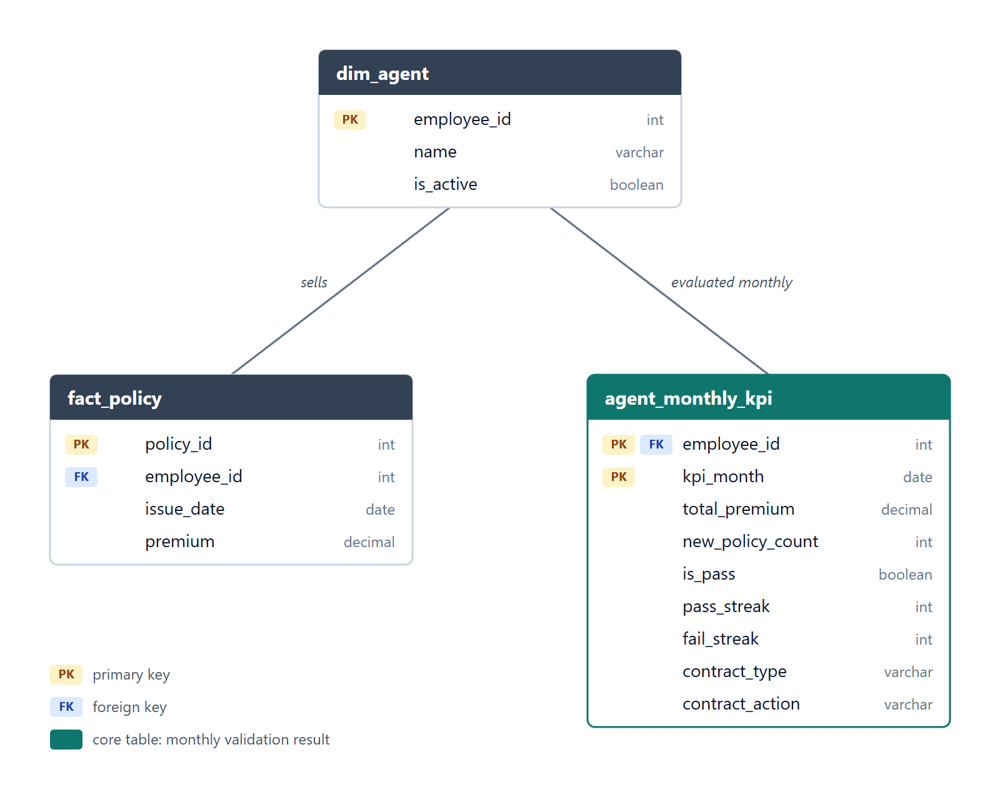

# Test Case #1 — Data Modeling: agent KPI validation

## The task
Sales changed the agent KPI. Every month an agent **passes** if:
- total premium > 15,000 baht, **and**
- new policies > 5.

**3 consecutive fails** → contract changes to commission-based.
**3 consecutive passes** → contract changes to salary-based.

The brief gives two instructions that overlap:
1. *Design fields/table(s) to track the validation and performance* → says **what** to store: performance (premium, policy count) and the validation result (pass/fail).
2. *The tables must track the validation result on a monthly basis* → says the **grain**: one row per agent per month.

Both are answered by one core table, `agent_monthly_kpi`. The other two tables feed it.

## ER (entity-relationship) diagram

Source: [`er_diagram.svg`](er_diagram.svg). PK = primary key, FK = foreign key.

## Tables

- **`dim_agent`**: one row per agent. `is_active` decides who gets evaluated each month.
- **`fact_policy`**: one row per policy sold. `issue_date` decides which month it counts toward; `premium` is summed for the KPI.
- **`agent_monthly_kpi`**: one row per active agent per month, including zero-sales months. Totals the month's policies and premium, marks pass/fail, updates the pass/fail streaks, and records the contract held plus any switch triggered when a streak reaches 3.

## Data dictionary

### `dim_agent`
| Name | Data type | Key | Example |
|---|---|---|---|
| `employee_id` | int | PK | 1001 |
| `name` | varchar(100) | | Somchai Jaidee |
| `is_active` | boolean | | true |

### `fact_policy`
| Name | Data type | Key | Example |
|---|---|---|---|
| `policy_id` | int | PK | 500123 |
| `employee_id` | int | FK → `dim_agent` | 1001 |
| `issue_date` | date | | 2026-10-14 |
| `premium` | decimal(12,2) | | 3200.00 |

### `agent_monthly_kpi`
| Name | Data type | Key | Example |
|---|---|---|---|
| `employee_id` | int | PK, FK → `dim_agent` | 1001 |
| `kpi_month` | date | PK | 2026-10-01 |
| `total_premium` | decimal(12,2) | | 18500.00 |
| `new_policy_count` | int | | 6 |
| `is_pass` | boolean | | true |
| `pass_streak` | int | | 3 |
| `fail_streak` | int | | 0 |
| `contract_type` | varchar(20) | | COMMISSION |
| `contract_action` | varchar(20) | | TO_SALARY |

`contract_type`: `SALARY` / `COMMISSION`. `contract_action`: `NONE` / `TO_COMMISSION` / `TO_SALARY`.

## How the tables connect
- An agent sells many policies; each policy belongs to one agent.
- An agent has one KPI row per month; each row belongs to one agent.

## Monthly process
1. At month end, create one `agent_monthly_kpi` row for every active agent.
2. Fill `total_premium` and `new_policy_count` from `fact_policy` (0 if no sales).
3. Set `is_pass`, then the streaks from the previous month's row.
4. Set `contract_type` from the previous month's row (applying its `contract_action`), or `SALARY` for a new agent.
5. If `fail_streak >= 3` and the contract is `SALARY` → `TO_COMMISSION`. If `pass_streak >= 3` and the contract is `COMMISSION` → `TO_SALARY`. Otherwise `NONE`.

## Assumptions
- **Strict thresholds**: exactly 15,000 baht or exactly 5 policies fails, because the brief says "more than".
- **New policy** = any policy issued in the month. **Premium** = the premium amount recorded on each policy.
- **Zero-sales month = fail.**
- **New agents start on a salary-based contract** (not specified in the brief).
- **Streaks do not reset on a contract switch.** A 4th fail while already on commission just gives `contract_action = NONE`.
- **A contract change takes effect the following month**: the next row's `contract_type` shows the new contract.

## Left out on purpose (possible extensions)
- **Rule-version table** for the thresholds (15,000 / 5 / 3) with effective dates, so a future KPI change is a new row, not a logic change.
- Cancellations and refunds (would need a `cancel_date` on `fact_policy`).
- Contract changes outside the KPI rule, e.g. manual overrides by managers (would need a contract history table).
- Agent attributes like team, branch; grace period for new hires; partial months.
