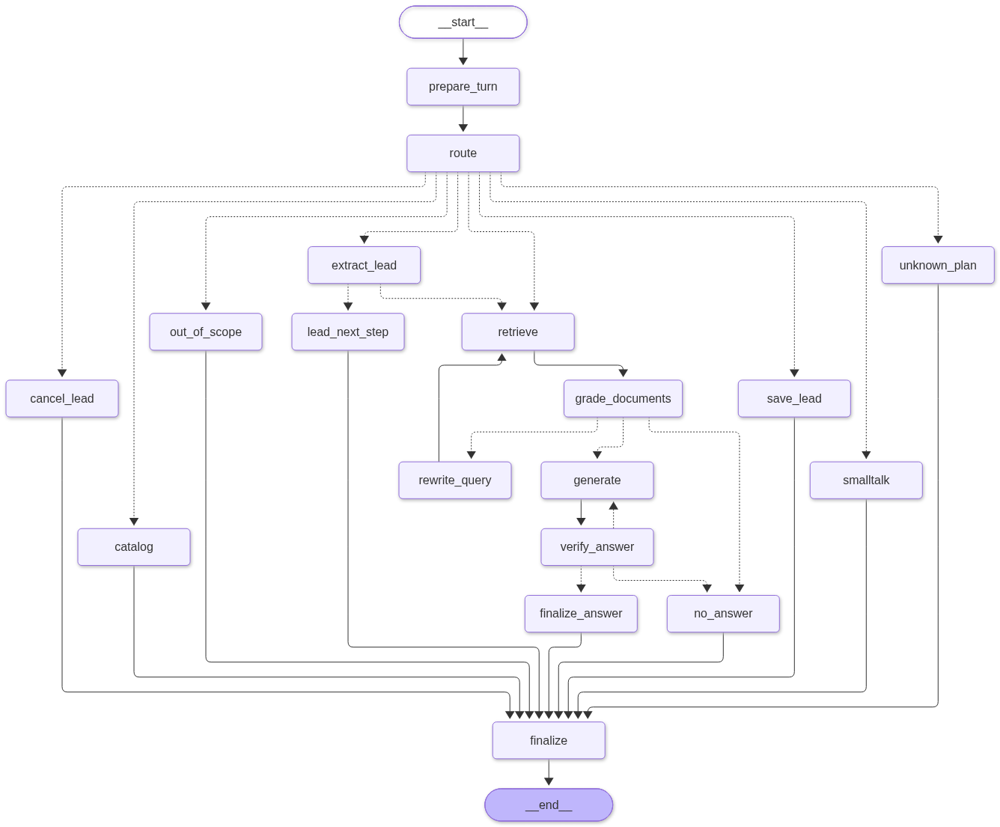

# InsureX Sales Assistant

An AI agent for InsureX sales staff and customers, built with **LangChain + LangGraph** and **ChromaDB**.

* **Answers questions** about 5 life-insurance products from the official brochures (`data/pdfs/`), in Thai or English, with the source page for every answer. If the brochures don't contain the answer, it says so instead of guessing.
* **Collects leads**: when a customer says they are interested, it asks for name, occupation, monthly income and phone, checks them, asks for PDPA consent, and saves the lead to SQLite through an **MCP (Model Context Protocol) tool**.
* **Keeps each customer's conversation separate**, and remembers it after a restart.

Full design notes, evaluation details and known issues: [docs/TECHNICAL.md](docs/TECHNICAL.md).

## Setup

Python 3.11+ (tested on 3.13).

```bash
python -m venv .venv
.venv\Scripts\activate            # macOS/Linux: source .venv/bin/activate
pip install -r requirements.txt
cp .env.example .env              # Windows: copy .env.example .env
```

Put an API key in `.env`: `OPENAI_API_KEY=...` (default: gpt-5-mini, a few US cents for everything below).
No OpenAI key? Use a free Google Gemini key (Option B in `.env.example`), or run fully offline with no key (Option E: rule-based answers, for testing only).

```bash
python -m insurex_agent.ingestion.build_index    # read the 5 PDFs and build the search index (~20 s)
python -m pytest -q                               # 60 tests, run offline
```

## How to use

```bash
python -m insurex_agent.cli chat                  # chat with the agent
python -m insurex_agent.cli chat --debug          # ... and show the LangGraph path of every answer
```

Try: `มีประกันอะไรบ้าง` → `90/20 คืออะไร` → `ผมอายุ 35 ต้องจ่ายปีละเท่าไหร่` → `เทียบกับ 99/99 ต่างกันยังไง` → `สนใจ` → give your details → `ยืนยัน`.

In the chat: `/new` new customer · `/switch <id>` change customer · `/history` · `/leads` saved leads · `/sessions` · `/forget` erase a customer's data · `/quit`

Other commands: `python -m insurex_agent.cli leads` (list leads) · `python -m insurex_agent.cli forget <id>` · `python scripts/run_showcase.py` and `python scripts/run_demo.py` (scripted demos, written to `logs/`).

## LangGraph structure



| Part | Nodes | What happens |
|---|---|---|
| Understand | `prepare_turn`, `route` | Summarise long chats; decide what the customer wants and which product they mean |
| Answer from brochures | `retrieve`, `grade_documents`, `rewrite_query` | Hybrid search (meaning + keywords, filtered by product). If nothing useful is found, rewrite the question and search again (**cycle 1**) |
| Check the answer | `generate`, `verify_answer` | Write the answer with citations; every number must appear in the sources. If not, write it again (**cycle 2**), otherwise say "not found" (`no_answer`) |
| Collect a lead | `extract_lead`, `lead_next_step`, `save_lead`, `cancel_lead` | Take details from the customer's words, ask for what is missing, confirm + consent, save through MCP |
| Fixed replies | `catalog`, `unknown_plan`, `smalltalk`, `out_of_scope` | Product list, unknown plan codes ("99/50"), greetings, unrelated topics: no LLM needed |

Design choices:
* **The LLM never writes to the database.** Saving happens only in code, after validation and the customer's consent.
* **Deterministic guards around the LLM**: answer language, products the customer actually named, plan codes that exist, the product list.
* **Every LLM step has a rule-based fallback**, so an API outage degrades the answers instead of crashing.
* **Sessions** are LangGraph threads stored by a SQLite checkpointer; old messages are summarised so prompts stay short.

## Results

* **Answers**: 40/41 on a set of test questions with gpt-5-mini (the one miss is a correct answer worded differently from the expected text). All 4 out-of-scope questions are refused.
* **Retrieval**: with the product filter, the right brochure section is in the top 4 results for every test question.
* **Logs**: `logs/showcase_openai-gpt-5-mini.log` (a customer journey from question to saved lead, plus a second customer in parallel), `logs/demo_openai-gpt-5-mini.log` (multi-session demo with a restart), `eval/results/`.
