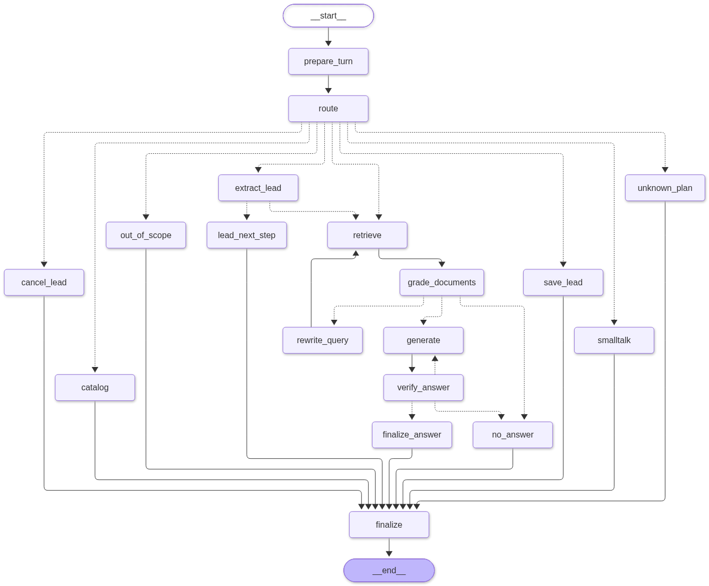

# InsureX Sales Assistant — technical notes

> Full design, evaluation and known issues. For setup and a short overview, see the [README](../README.md).

AI agent that helps sales staff and customers with **5 InsureX / FWD life-protection products**. It answers questions from the official product brochures (PDF), **collects leads** into SQLite through an **MCP (Model Context Protocol) tool** when a customer says they are interested, and **remembers each conversation separately** across restarts.

> **สรุปภาษาไทย** — ระบบ AI Agent ผู้ช่วยพนักงานขาย สร้างด้วย **LangChain + LangGraph** ใช้ **ChromaDB** เป็น vector database ตอบคำถามจากโบรชัวร์ PDF ทั้ง 5 ผลิตภัณฑ์ พร้อมอ้างอิงแหล่งที่มา (ไฟล์/หน้า) ทุกคำตอบ
> - **RAG**: แยกข้อความภาษาไทยจาก PDF แบบเข้าใจ layout (แก้ปัญหาวรรณยุกต์หายจาก font PUA), chunk แบบ parent/child, ค้นหาแบบ hybrid (dense + BM25 คำ + BM25 ตัวอักษร) รวมผลด้วย RRF (Reciprocal Rank Fusion)
> - **LangGraph**: มี 2 cycle — (1) ค้นไม่เจอ → เขียน query ใหม่ → ค้นอีกครั้ง (2) คำตอบไม่ผ่านการตรวจสอบตัวเลข/ข้อเท็จจริง → สร้างคำตอบใหม่ หากยังไม่ผ่านจะตอบว่า "ไม่พบข้อมูล" แทนการเดา
> - **Bonus 1**: เมื่อลูกค้าบอกว่า "สนใจ" ระบบเข้าโหมดเก็บ lead ดึง ชื่อ/อาชีพ/รายได้/เบอร์โทร เป็น Pydantic model, ตรวจว่าข้อมูลมาจากข้อความลูกค้าจริง, ขอความยินยอมตาม PDPA (พ.ร.บ.คุ้มครองข้อมูลส่วนบุคคล) แล้วบันทึกลง SQLite ผ่าน **MCP server**
> - **Bonus 2**: แยก session ด้วย `thread_id` + LangGraph SQLite checkpointer (คุยต่อได้หลังรีสตาร์ท), สรุปประวัติสนทนาอัตโนมัติเมื่อยาวเกินกำหนด
> - มี test 60 ข้อ (รันได้โดยไม่ต้องมี API key), ชุดประเมิน 41 คำถาม, และ log ตัวอย่างการทำงาน

---

## Contents
1. [Brief → implementation](#1-brief--implementation)
2. [Quick start](#2-quick-start)
3. [Knowledge base: which 5 PDFs and why](#3-knowledge-base-which-5-pdfs-and-why)
4. [Architecture](#4-architecture)
5. [LangGraph design (nodes, state, cycles)](#5-langgraph-design)
6. [Ingestion: getting clean Thai out of the PDFs](#6-ingestion-getting-clean-thai-out-of-the-pdfs)
7. [Retrieval](#7-retrieval)
8. [Answer generation & error handling](#8-answer-generation--error-handling)
9. [Bonus 1 — Lead collection over MCP](#9-bonus-1--structured-lead-collection-over-mcp)
10. [Bonus 2 — Session management](#10-bonus-2--session-management)
11. [Evaluation](#11-evaluation)
12. [Demo logs](#12-demo-logs)
13. [Project layout](#13-project-layout)
14. [Design decisions, limitations, next steps](#14-design-decisions-limitations-next-steps)

---

## 1. Brief → implementation

| Requirement | Where / how |
|---|---|
| LangChain + LangGraph state management | `insurex_agent/agent/graph.py` — 16-node `StateGraph`, typed `AgentState`, conditional edges, two cycles |
| Vector DB: ChromaDB or FAISS | **ChromaDB** (persistent, cosine) — chosen for native metadata filtering by product (`insurex_agent/retrieval/store.py`) |
| Answer from the 5 PDFs | `data/pdfs/` → layout-aware parser → parent/child chunks → hybrid retrieval → grounded generation with citations |
| Error handling when no answer | corrective re-retrieval, relevance grading, number/fact verification, explicit "not found" fallback with hand-off; LLM/tool outages degrade instead of crashing (§8) |
| **Bonus 1** MCP lead tool, mode triggered by interest | `insurex_agent/leads/mcp_server.py` (FastMCP, tools `save_lead`, `get_lead`, `list_leads`, `delete_leads`), lead mode in the graph (§9) |
| Extract name, occupation, income, phone as structured data | `LeadExtraction` / `LeadRecord` Pydantic models + grounding check (`insurex_agent/leads/models.py`) |
| Save to a database | SQLite `leads` + `lead_events` audit table, idempotent upsert (`insurex_agent/leads/repository.py`) |
| **Bonus 2** session separation + efficient history recall | `thread_id` per session, `AsyncSqliteSaver` checkpointer, session registry, rolling summary + windowed history (§10) |
| requirements.txt, README, demo/test logs | this file, `requirements.txt`, `logs/`, `eval/results/`, `tests/` |

## 2. Quick start

```bash
# Python 3.11+  (developed on 3.13)
python -m venv .venv && source .venv/bin/activate        # Windows: .venv\Scripts\activate
pip install -r requirements.txt

cp .env.example .env          # put ONE provider's key in .env (OpenAI default; Gemini has a free tier)

python -m insurex_agent.ingestion.build_index             # parse 5 PDFs -> Chroma + BM25 (≈10 s)
python -m insurex_agent.cli chat --debug                  # chat; --debug prints the node trace
```

| Command | What it does |
|---|---|
| `python -m insurex_agent.cli chat --session alice --debug` | interactive chat; in-chat commands `/new`, `/switch <id>`, `/history`, `/state`, `/leads`, `/sessions`, `/forget [id]` |
| `python -m insurex_agent.cli ask "คุ้มชีวา 90/10 จ่ายเบี้ยกี่ปี"` | one-shot question |
| `python -m insurex_agent.cli leads` | list saved leads (through the MCP `list_leads` tool) |
| `python -m insurex_agent.cli forget <session_id>` | erase a session and its leads (PDPA right to erasure); asks for confirmation, `--yes` skips it |
| `python scripts/run_showcase.py` | short customer journey (reject → catalogue → product → compare → lead with consent) + an interleaved English customer, on a fresh state folder → `logs/showcase_<llm>.log` |
| `python scripts/run_demo.py` | scripted multi-session demo incl. invalid input and a process restart → `logs/demo_<llm>.log` |
| `python scripts/eval_retrieval.py` | retrieval ablation (no LLM needed) |
| `python scripts/eval_agent.py` | end-to-end answer evaluation on 41 questions |
| `python -m pytest -q` | 60 tests, fully offline |
| `python -m insurex_agent.cli graph` | print the LangGraph as Mermaid |

`make install | index | chat | demo | eval | test | mcp-inspect` wraps the same commands.

**Providers** (set in `.env`, see `.env.example`): OpenAI (`gpt-5-mini` + `text-embedding-3-small`, default), Google Gemini (`gemini-flash-latest` + `gemini-embedding-001`), Anthropic (LLM only), Ollama (fully local), or `LLM_PROVIDER=offline` + `EMBEDDING_PROVIDER=local` (no keys, no network — rule-based brain and an LSA embedder; used by the tests). Rebuild the index after changing the embedding provider; the index refuses to load with a mismatched embedder.

## 3. Knowledge base: which 5 PDFs and why

HR asked for 5 brochures from the InsureX website. Seven were downloaded from the life-protection page; five were kept so the knowledge base is one coherent product family (life protection, all underwritten by FWD):

| File (`data/pdfs/`) | Product | Type |
|---|---|---|
| `khum_cheeva_90_10.pdf` | คุ้มชีวา 90/10 | whole life to 90, pay 10 yrs, bundled riders |
| `khum_cheevee_extra_99.pdf` | คุ้มชีวี เอ็กซ์ตร้า 99/10, 99/15, 99/20 | participating whole life, 1 % annual cash-back |
| `whole_life_99_99.pdf` | ตลอดชีพ 99/99 | whole life, pay to 99 |
| `whole_life_90_20.pdf` | ตลอดชีพ 90/20 | whole life to 90, pay 20 yrs |
| `khum_manjai_sure_term.pdf` | คุ้มมั่นใจชัวร์ แบบชั่วระยะเวลา 5/5, 10/10, 15/15 | term life |

Dropped: **Protection Sure** (a health package covering in-patient and out-patient care, not life protection; a 6-column × 24-row benefit matrix with merged cells) and **คุ้มมั่งมี 18/9** (an endowment/savings plan). Keeping two near-identical whole-life plans (99/99 vs 90/20) is deliberate: it is the realistic hard case for retrieval precision (same vocabulary, different numbers).

## 4. Architecture

```
                 OFFLINE (build_index)                                   ONLINE (per turn)
 PDF ─► layout-aware parser ─► Thai repair + quality gate         user ─► LangGraph agent ─► answer + citations
        (PyMuPDF line boxes)    (Private-Use-Area glyphs→Unicode, ำ, orphan marks)                 │      │
                 │                                                         ┌────┘      └────────────┐
                 ▼                                                         ▼                        ▼
   parent sections + child chunks (rows/paragraphs/legal)          HybridRetriever             MCP client
   with contextual headers + product/section/page metadata         dense ⊕ BM25 ⊕ char-BM25    (stdio) ─► MCP server
                 │                                                  RRF → parents                         │
       ┌─────────┴──────────┐                                                                    SQLite leads.sqlite
       ▼                    ▼                                     AsyncSqliteSaver checkpoints (per session thread)
  ChromaDB (dense)   BM25 word + char-3gram                       SQLite sessions registry
```

* **Brain** (`agent/brain.py`): every language-understanding step (route, grade, generate, verify, extract, summarise) goes through one interface with two implementations — `LLMBrain` (structured outputs via Pydantic) and `RuleBrain` (deterministic). `RuleBrain` is the per-call fallback when the LLM fails and the full brain in offline mode, so the graph logic is identical and testable without a key.
* **Deterministic code owns data integrity**: lead validation, PDPA (Thai Personal Data Protection Act) consent, persistence, citations and the number check never depend on the LLM.

## 5. LangGraph design



| Node | Purpose |
|---|---|
| `prepare_turn` | reset per-turn fields, detect language, **summarise and trim** old messages when the thread is long |
| `route` | LLM structured output `RouteDecision`: intent, `wants_contact`, `has_question`, products (resolving "แผนนี้" from history), standalone query, language. A bare "ยืนยัน/yes" while awaiting confirmation is forced to `confirm` deterministically. Deterministic guards: the reply language comes from the message's script, and when the customer names products the router may not add others (except products already in focus) |
| `retrieve` | hybrid retrieval; attempt 1 filters by the products the router resolved, attempt 2 drops the filter |
| `grade_documents` | LLM `GradeResult` — which context blocks are relevant, is it answerable. Judged against the customer's question (router's standalone query), not the retry rewrite. Not answerable → `rewrite_query`; on the **last attempt** the relevant blocks are used for a partial answer (trace `grade_documents:partial n/4`) |
| `rewrite_query` | reformulate with brochure vocabulary → back to `retrieve` (**cycle 1, corrective RAG**) |
| `generate` | answer only from numbered context, cite `[n]`, state the conditions of example premiums |
| `verify_answer` | deterministic **number check** (every amount ≥ 1,000 and every % must exist in the context) + LLM grounding check; failure → `generate` with feedback (**cycle 2, self-correction**) |
| `finalize_answer` | append the source list (file + page) from the cited blocks; update products in focus |
| `no_answer` | nothing relevant in any attempt, or two drafts failed verification: "not found in the brochures" + list of covered products + hand-off (Contact Center 1314 / offer an agent) |
| `extract_lead` | LLM `LeadExtraction` → grounding against the customer's words → merge into the lead draft |
| `lead_next_step` | ask for missing fields, or show a summary and ask for confirmation + PDPA consent |
| `save_lead` | build a validated `LeadRecord` → **MCP tool `save_lead`** → SQLite |
| `cancel_lead` | discard the draft (nothing is stored without consent) |
| `smalltalk`, `out_of_scope` | short templated replies that steer back to the products |
| `catalog` | "มีประกันอะไรบ้าง": lists the 5 products from the catalogue (master data, no retrieval). A question naming one product ("คุ้มชีวามีแบบอะไรบ้าง") or an insurance type InsureX does not sell here ("ประกันรถยนต์มีอะไรบ้าง") stays a RAG question, so the latter ends in "not found" instead of our life plans |
| `unknown_plan` | the message contains a plan code no product has ("คุ้มชีวา 99/50"): say so, list the real plans, ask which one was meant. No product is guessed and no lead is started |
| `finalize` | write the AI message; if a lead is being collected and the turn was a Q&A detour, append the next lead question |

**State** (`AgentState`, persisted per session): `messages` (with `add_messages` reducer), `summary`, `mode` (`qa` / `lead_collection`), `lead`, `lead_status` (`collecting` → `awaiting_confirmation` → `saved` / `cancelled`), `lead_id`, `active_products`; per-turn fields `route`, `query`, `retrieval_attempt`, `generation_attempt`, `retrieved`, `relevant`, `draft`, `verification`, `answer`, `sources`, `turn_trace` (custom reducer that resets each turn — this is what the demo logs print).

A customer can ask a product question in the middle of lead collection ("ผมชื่อสมชาย แล้วแผนนี้ลดหย่อนภาษีได้ไหม"): `extract_lead` runs first, then the RAG path answers, and `finalize` resumes collection by asking for the remaining fields.

## 6. Ingestion: getting clean Thai out of the PDFs

The brochures are Adobe Illustrator exports using the SukhumvitSet font. Three problems had to be solved before any retrieval could work (`insurex_agent/ingestion/`):

1. **Missing tone marks.** Shifted Thai tone marks/vowels are emitted as Private-Use-Area glyphs (U+F700–F71A), so naive extraction gives "คุมครอง" instead of "คุ้มครอง" and "ทํางาน" instead of "ทำงาน". `repair_thai()` maps PUA → Unicode and recomposes SARA AM.
2. **Layout.** Pages mix full-width paragraphs, 2–4-column feature boxes and tables. Generic converters interleave the feature-box columns line by line, and one popular PDF→Markdown tool split Thai combining marks into the wrong table cells and swapped the male/female premium columns. `pdf_parser.py` clusters PyMuPDF line boxes into visual rows and classifies them: tightly stacked multi-column blocks are emitted column by column; isolated label/value rows become table rows; small print is processed as its own layer.
3. **Quality gate.** `thai_quality_issues()` counts orphaned/stacked combining marks on every page and the index build logs them; all 13 pages currently score 0 (asserted in `tests/test_ingestion.py`). Parsed markdown is saved in `data/processed/` for inspection.

**Chunking (parent/child, "small-to-big")** — `chunker.py`:
* every **table row** becomes a self-contained fact with a contextual header, e.g.
  `ตลอดชีพ 90/20 > ตัวอย่างเบี้ยประกันภัยรายปี > เพศหญิง อายุ 35 ปี: แผน 1 (ทุนประกัน 200,000 บาท) = 4,460 | … | แผน 3 (ทุนประกัน 500,000 บาท) = 10,650 | …`
  (the brochure only says "แผน 3" in the premium table; the sum assured comes from the table above it and is attached automatically);
* feature boxes / paragraphs and legal bullets are separate children; a product card (master data) per product;
* the **parent** (whole section: full table, footnotes) is what the LLM reads. 33 parents / 207 children in total.

## 7. Retrieval

`HybridRetriever` (`retrieval/hybrid.py`) fuses three rankers with Reciprocal Rank Fusion:

| Ranker | Why |
|---|---|
| Dense (Chroma, cosine) | paraphrases: "ตายจากอุบัติเหตุ" ↔ "เสียชีวิตจากอุบัติเหตุ", English questions |
| BM25 (Best Match 25 keyword ranking) on Thai words (PyThaiNLP `newmm` + product dictionary; codes like `90/10` kept as one token) | exact product codes, amounts, terms |
| BM25 on character 3-grams | Thai has no spaces — robust to word-segmentation mismatches ("รับประกัน" vs "รับ ประกันภัย") |

Plus: colloquial→brochure query expansion (`ทุน`→`จำนวนเงินเอาประกันภัย`, `ผู้หญิง`→`เพศหญิง`, …), hard product filter on the first attempt, optional section boosts (off by default — see below), child→parent lifting, and per-product diversity for comparison questions.

Retrieval ablation on the 37 answerable eval questions (top-4 parents), with two embedders: OpenAI `text-embedding-3-small` (what the agent uses) and the offline LSA (Latent Semantic Analysis: TF-IDF + SVD) embedder. BM25 rows do not depend on the embedder. Hit@k = share of questions whose gold section is in the top k; MRR = Mean Reciprocal Rank.

| Config | Hit@1 OpenAI | Hit@1 LSA | Hit@4 OpenAI | Hit@4 LSA | MRR OpenAI | MRR LSA | Product precision@4 OpenAI | Product precision@4 LSA |
|---|---|---|---|---|---|---|---|---|
| dense only | 0.62 | 0.78 | 0.89 | 1.00 | 0.73 | 0.88 | 0.86 | 0.79 |
| BM25 word only | 0.86 | 0.86 | 1.00 | 1.00 | 0.92 | 0.92 | 0.73 | 0.73 |
| BM25 char-3gram only | 0.81 | 0.81 | 0.97 | 0.97 | 0.88 | 0.88 | 0.69 | 0.69 |
| hybrid (RRF) | 0.89 | 0.95 | 1.00 | 1.00 | 0.95 | 0.97 | 0.74 | 0.71 |
| hybrid + section boosts | 0.92 | 0.92 | 1.00 | 1.00 | 0.96 | 0.95 | 0.74 | 0.69 |
| **hybrid + product filter** (what the agent uses on attempt 1) | **0.89** | **0.95** | **1.00** | **1.00** | **0.94** | **0.97** | **1.00** | **1.00** |
| hybrid + section boosts + product filter | 0.92 | 0.92 | 1.00 | 1.00 | 0.95 | 0.96 | 1.00 | 1.00 |

* **Hybrid beats every single ranker** on Hit@1 and MRR with both embedders, and with the product filter the right section is in the top 4 for every question.
* **Product precision matters most for this catalogue**: an LLM shown both the 90/20 and 99/99 premium tables is the classic way to quote the wrong number; the product filter takes it from 0.74 to 1.00 with no loss elsewhere. If the router picked the wrong product, the corrective loop retries without the filter.
* **Dense alone is weaker with OpenAI than with LSA.** LSA is fitted on these exact 207 chunks, so it is tuned to the corpus vocabulary; a general-purpose embedder is not. This is why the BM25 rankers matter for Thai brochure text.
* **Section boosts** (premium words → premium tables) change Hit@1 by one question out of 37, and the sign flips between embedders (+1 with OpenAI, −1 with LSA). That is within noise, so they stay **off by default** (`SECTION_BOOSTS=false`) for simplicity, kept in the code as a switch.

Results: `eval/results/retrieval_insurex_kb_openai_text_embedding_3_small.md` and `…_local_lsa_256.md`; the script reruns the whole table in one command.

## 8. Answer generation & error handling

* **Grounded prompt**: answer only from numbered context; never compute new premiums; when quoting an example premium, state its conditions (gender, age, occupation class, sum assured); say explicitly what the brochure does not specify; reply in the customer's language; cite `[n]`. The source list (file + page) is appended by code from the cited blocks, so citations cannot be hallucinated.
* **Verification**: `unsupported_numbers()` rejects any amount ≥ 1,000 or percentage not present in the context; optional LLM grounding check (`VERIFY_WITH_LLM`). Two failed drafts → `no_answer` rather than a wrong figure.

| Failure | Behaviour |
|---|---|
| Nothing relevant retrieved | grade → rewrite query → retrieve without filter → still nothing → `no_answer` (no guessing, list of covered products, Contact Center 1314, offer an agent) |
| Partial evidence (e.g. "คุ้มชีวากับคุ้มชีวี เอ็กซ์ตร้า ต่างกันยังไง", or a premium the brochure only shows for another age) | the grader finds relevant blocks but not a complete answer → corrective retry → on the last attempt the agent answers from those blocks, states what the brochures do not specify, offers hand-off; verification still applies. Before this change a broad comparison was refused even though both brochures had been retrieved |
| Draft contains unsupported number/claim | regenerate with the fact-checker's feedback; then fall back |
| LLM call fails (timeout, 429, invalid JSON) | that step falls back to `RuleBrain`; the turn is flagged `degraded_steps` in the logs |
| Embedding API fails | retrieval continues with the two BM25 rankers |
| Lead value not found in the customer's words / invalid phone | value rejected, customer asked again |
| Plan code that does not exist ("สนใจคุ้มชีวา 99/50") | `unknown_plan`: no lead is started and no product is guessed (product detection would otherwise match "คุ้มชีวา" and record 90/10 as the product of interest) |
| MCP server rejects payload | errors shown, collection resumes |
| MCP server/transport down | draft kept, customer asked to confirm again; upsert makes the retry idempotent |
| Index missing / built with another embedder | clear error telling you to run `build_index` |

## 9. Bonus 1 — Structured lead collection over MCP

**Trigger.** The router sets `wants_contact=true` for interest ("สนใจ", "อยากสมัคร", "ให้ตัวแทนติดต่อกลับ", "I'm interested") → `mode = lead_collection`, `lead_status = collecting`, and the product in focus becomes `product_interest`.

**Extraction → validation → consent → persistence**

1. `extract_lead`: LLM returns `LeadExtraction` (all fields optional, values copied as written).
2. `ground_extraction`: each value must literally appear in the customer's message (the model cannot invent a phone number); phone normalised to Thai national format (`+66 81-234-5678` → `0812345678`) and validated; income parsed from Thai shorthand (`5 หมื่น`, `3.5 หมื่น`, `35k`, `สามหมื่นห้า`) and normalised to **monthly** baht (`6 แสนต่อปี` → 50,000/month).
3. When all four fields are present the agent shows a summary and asks for confirmation **and PDPA consent**. Nothing is written before an explicit "ยืนยัน/yes"; "ยกเลิก" discards the draft.
4. `save_lead` builds a `LeadRecord` (Pydantic: name without digits/titles, valid phone, income > 0, `consent=True` required) and calls the **MCP tool**.

**MCP server** (`python -m insurex_agent.leads.mcp_server`, stdio, FastMCP). The agent connects with `langchain-mcp-adapters` and keeps one session open for the app's lifetime.

| Tool | Arguments | Returns |
|---|---|---|
| `save_lead` | `session_id, full_name, occupation, monthly_income, phone, consent, product_interest?, income_text?` | `{ok, lead_id, status: created\|updated}` or `{ok: false, errors}` |
| `get_lead` | `lead_id` | `{ok, lead}` |
| `list_leads` | `limit=20, session_id?` | `{ok, leads}` |
| `delete_leads` | `session_id` | `{ok, deleted: [lead_id, ...]}`; also deletes the leads' `lead_events` (they hold a copy of the personal data) |

The server re-validates every payload with the same `LeadRecord` model, so a buggy client still cannot write bad data. Upsert key is `(session_id, phone)` — retries never duplicate a lead; every write is appended to `lead_events` (audit trail).

```sql
CREATE TABLE leads (lead_id TEXT PRIMARY KEY, session_id TEXT NOT NULL, full_name TEXT NOT NULL,
  occupation TEXT NOT NULL, monthly_income REAL NOT NULL CHECK (monthly_income > 0), income_text TEXT,
  phone TEXT NOT NULL CHECK (length(phone) BETWEEN 9 AND 10), product_interest TEXT,
  consent INTEGER NOT NULL CHECK (consent = 1), status TEXT DEFAULT 'new', source TEXT,
  created_at TEXT, updated_at TEXT, UNIQUE (session_id, phone));
```

Using the tool outside the agent:
* MCP Inspector: `npx @modelcontextprotocol/inspector python -m insurex_agent.leads.mcp_server`
* Any MCP client (e.g. Claude Desktop) — add to its config:
  ```json
  {"mcpServers": {"insurex-leads": {"command": "/abs/path/.venv/bin/python",
     "args": ["-m", "insurex_agent.leads.mcp_server"],
     "env": {"PYTHONPATH": "/abs/path/insurex-sales-agent",
             "LEADS_DB_PATH": "/abs/path/insurex-sales-agent/data/state/leads.sqlite"}}}}
  ```
* CLI: `python -m insurex_agent.cli leads`

Design choice: the LLM never gets direct write access to the database (it does not tool-call `save_lead` itself). The graph calls the tool only after validation and consent — deterministic control over the one irreversible action.

## 10. Bonus 2 — Session management

* **Separation**: every conversation is a LangGraph thread (`thread_id = session_id`). The whole `AgentState` — messages, summary, lead draft, products in focus — is checkpointed per thread, so two customers can talk concurrently without sharing context (tested with `asyncio.gather`, and shown in the demo: Bob's "this plan" resolves to *his* product).
* **Persistence**: `AsyncSqliteSaver` (`data/state/checkpoints.sqlite`). Restarting the process and calling the same `session_id` resumes the conversation, including a half-collected lead (tested and shown in the demo).
* **Efficient recall**: the LLM sees only the last `HISTORY_WINDOW` (8) messages plus a running summary. When a thread exceeds `SUMMARIZE_AFTER` (16) messages, `prepare_turn` folds the oldest into the summary and deletes them from state (`RemoveMessage`), so prompt size stays flat. Structured facts that must not be lost (lead fields, products in focus) live in typed state, not in chat text.
* **Registry**: `data/state/sessions.sqlite` (session id, user id, channel, created / last active, turns) for listing/resuming (`/sessions`, `cli sessions`).
* **Erasure** (PDPA right to erasure): `cli forget <session_id>` or `/forget` deletes, in this order, the session's leads (through the MCP `delete_leads` tool), its checkpointed conversation (`checkpointer.adelete_thread`) and its registry row. Leads go first: if the tool call fails nothing else is deleted and the command can be retried. `cli forget` does not need an API key or the index.

## 11. Evaluation

`eval/qa_set.jsonl` — 41 questions written from the brochures: premiums, benefits, underwriting rules, legal/company facts, a comparison, two English questions, and 4 negatives (car insurance, travel insurance, a premium the brochure does not list, a stock price). Every gold fact was checked to exist verbatim in the parsed knowledge base.

* `scripts/eval_retrieval.py` — Hit@1/Hit@k/MRR (Mean Reciprocal Rank)/product-precision for six retrieval configurations (table in §7).
* `scripts/eval_agent.py` — runs every question through the full graph and scores the final answer (answerable: contains the gold facts; negatives: took the fallback instead of answering; not-in-doc: no amount that is absent from the brochure).

Results are written to `eval/results/` (`agent_<llm>.md` summary, `agent_<llm>.jsonl` with every full answer and node trace).

| Run | Score | Notes |
|---|---|---|
| Offline (rule brain + LSA, no LLM) | 32/41 (78 %) | the floor the system degrades to if the LLM is unavailable |
| gpt-5-mini, first run | 38/41 (93 %) | 0 rule fallbacks; failures: ambiguous age question ×2, English answer scored against a Thai fact |
| gpt-5-mini, after the answer fixes | 41/41 | 0 rule fallbacks |
| gpt-5-mini, **final code** (after the product guard, catalogue and unknown-plan checks) | **40/41** | 0 rule fallbacks; median latency ≈ 12 s per question (about 4 LLM calls). The one "failure" (`term-uw-1`) is a correct answer phrased "อายุตั้งแต่ 20 ปี ถึง 50 ปี" while the gold fact is the literal "20 - 50 ปี" - left as a failure rather than loosening the scorer again |

How to read these numbers honestly:
* **They vary between runs.** gpt-5-mini is a reasoning model: it only accepts its default sampling (temperature cannot be set) and no seed is used, so the LLM steps are not deterministic. Runs after the fixes below scored 40–41/41, and every miss in those runs was a correct answer phrased differently from the gold string. Retrieval, routing rules, validation and the save decision are deterministic.
* **Fixes were made using this set**, so 41/41 is not a held-out score. Changes between runs: the router keeps the customer's scope; the grader accepts broad comparisons; partial evidence is answered on the last attempt; ambiguous "รับประกัน…อายุ" questions get both entry age and coverage end; brochure hedges are kept ("โอกาสรับเงินปันผล"); the answer language comes from a deterministic script check instead of the LLM's guess; questions about InsureX itself are in scope.
* **Two scoring fixes** (scoring only, not the agent): the English dividend question also accepts "dividend", and the scorer ignores letter case and treats en/em dashes as "-" ("20–50 ปี" = "20 - 50 ปี").
* The set covers single Q&A turns. Lead collection and sessions are covered by the demo (§12) and the offline tests, not by this score.

## 12. Demo logs

`python scripts/run_demo.py` runs a scripted session and writes:

* `logs/demo_<llm>.log` — readable transcript; for every turn: intent, **node trace** (e.g. `route → retrieve#1 → grade_documents:0/4 → rewrite_query → retrieve#2 → … → no_answer:not_found`), mode, lead status and fields, products in focus, latency;
* `logs/turns.jsonl` — one structured JSON record per turn.

**Showcase** (`scripts/run_showcase.py`, `logs/showcase_openai-gpt-5-mini.log`): a casual Thai customer asks for car insurance (not in the knowledge base → refused after the corrective loop), browses the catalogue, asks what ตลอดชีพ 90/20 is, how much he pays at 35 and whether he can pay monthly, compares it with 99/99, says he is interested, gives name, occupation, income and phone in one message, and consents; the lead is saved through MCP. An English customer asking about term life is interleaved; his "it" resolves to his own plan.

Committed transcripts: `logs/showcase_openai-gpt-5-mini.log`, `logs/demo_openai-gpt-5-mini.log` (the real run: 18 turns, 0 rule fallbacks, every amount in the answers checked against the parsed brochures) and `logs/demo_offline-rules.log` (the same script with no LLM, showing graceful degradation).

Scenarios: Alice (Thai) asks premiums → follow-up with "แผนนี้" → comparison → interest → gives name + occupation **and** asks a tax question in the same message → gives an invalid phone (`08123`, rejected) → corrects it → PDPA confirmation → saved via MCP. Bob (English) is interleaved and saves his own lead. Then out-of-KB questions, a process restart that restores Alice's session from SQLite, and the leads table read back through the MCP `list_leads` tool.

## 13. Project layout

```
insurex_agent/
  config.py              settings (.env), paths, thresholds
  llm.py                 chat-model / embedding factories (+ offline LSA embedder)
  ingestion/             thai_text.py · pdf_parser.py · chunker.py · catalog.py · build_index.py
  retrieval/             store.py (Chroma + BM25 + docstore) · hybrid.py (RRF, filters, small-to-big)
  agent/                 schemas.py · prompts.py · brain.py (LLM + rule fallback) · graph.py · app.py · studio.py
  leads/                 models.py (Pydantic + grounding) · repository.py (SQLite) · mcp_server.py · gateway.py (MCP client)
  memory/                sessions.py (session registry)
  cli.py
data/pdfs/               the 5 source brochures
data/processed/          parsed markdown + chunks (for inspection)
eval/                    qa_set.jsonl, results/
scripts/                 run_demo.py · eval_retrieval.py · eval_agent.py
tests/                   60 offline tests (ingestion, retrieval, leads + real MCP round-trip, graph workflows)
logs/                    demo transcripts + structured turn logs
docs/graph.png           rendered LangGraph
```

## 14. Design decisions, limitations, next steps

**Decisions**
* *Chroma over FAISS*: product metadata filtering is central to precision here; FAISS would need a separate metadata layer.
* *Parent/child chunks with contextual headers*: brochure rows are meaningless out of context ("แผน 1 = 300,000" appears in four products).
* *Deterministic lead flow*: the questions, confirmation and persistence are code, not LLM free-text — predictable wording, no accidental writes, easy to audit.
* *LLM + rule fallback behind one interface*: graceful degradation, and the workflow is unit-testable offline.

**Limitations**
* The brochures contain only example premiums (specific age/gender/plan). The agent deliberately refuses to extrapolate — a real quote needs the insurer's rating engine.
* Offline mode (no LLM) is extractive and weak on English questions; it is a fallback/testing mode, not the product.
* LLM steps are not deterministic (gpt-5-mini accepts no temperature; no seed is set), and the 41-question set is small and was used while fixing the agent. A held-out question set would give a fairer score.
* Latency is about 10 s per question with gpt-5-mini (route, grade, generate, verify).
* The layout parser is tuned on this brochure family (FWD/InsureX template); a new template should be checked with the quality gate and the processed markdown.
* PII is stored in plain SQLite for the exercise.

**Found in live testing with gpt-5-mini, and fixed**

| Symptom | Cause | Fix |
|---|---|---|
| A follow-up comparison ("เปรียบเทียบกับ 99/99 ต่างกันยังไง") answered "not found" | the grader marked the retrieved blocks relevant but "not fully answerable", which discarded all evidence | partial evidence is answered on the last retrieval attempt; relevance is judged against the customer's question, not the retry rewrite |
| English questions sometimes answered in Thai | the router (asked for a Thai search query) mislabelled the language | language comes from a deterministic script check |
| "ประกันคุ้มชีวาแต่ละแบบต่างกันยังไง" answered about คุ้มชีวี เอ็กซ์ตร้า and claimed คุ้มชีวา was "not in the documents" | the router added a product the customer never named; the grounding check skipped "not specified" statements | product guard (named products only); "a product has no information" is never allowed and is flagged by the grounding check |
| "มีประกันอะไรบ้าง" refused or answered depending on the run | a catalogue question was sent through brochure search, where no passage lists all products | `catalog` intent answered from the product catalogue |
| "สนใจคุ้มชีวา 99/50" started a lead for คุ้มชีวา 90/10 | product detection matched the name and ignored the plan code | `unknown_plan` check against the catalogue's plan codes |

**Known issues (open)**
* Run-to-run variance of the LLM steps (see §11); a borderline question can be answered in one run and refused in the next.
* The คุ้มชีวี เอ็กซ์ตร้า brochure labels its "death before age 85" row as death from *accident*; the same row in the คุ้มชีวา brochure says death from *illness*. This looks like a typo in the source PDF; the agent quotes it faithfully with its page citation.
* The plan-code check treats any `n/n` pattern (e.g. a fraction "1/2") as a plan code; dates with a year are excluded.
* A catalogue question asked in the same message as personal details skips lead extraction for that turn.
* Long Thai answers take ~10 s; the CLI panel border can look uneven because terminals miscount the width of Thai combining marks.

**Production next steps**: encrypt personal data (PII) at rest and restrict `list_leads` by role; Postgres + pgvector (or managed Chroma) and a Postgres checkpointer; cross-encoder reranker (e.g. bge-reranker-v2-m3) after RRF; LangSmith tracing + the eval set in continuous integration; product-data feed instead of PDFs for premiums; streaming responses and a web/LINE channel; human hand-off with the lead summary pushed to the CRM (customer relationship management system).
